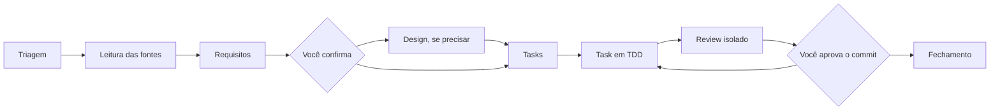

# Keel

Um plugin do Claude Code para desenvolver por especificação: uma história e uma task pequena por vez, com TDD em cada task e você aprovando cada passo.

Keel 2, pronto para uso no Claude Code.

## Por que o Keel existe

Seja sincero: quando foi a última vez que você leu, linha por linha, tudo o que a IA escreveu para você? E quando ela entregou aquele PR enorme que você aprovou meio no escuro, de quem era o bug depois?

A IA escreve código rápido. Rápido demais, às vezes. Ela gera arquivos, planos e textos longos, e no fim quem trabalha é você, revisando tudo e tentando descobrir o que mudou e por quê. Nessa pressa, o que faz um software durar costuma ficar para trás: entender o problema antes, testar primeiro, revisar com calma, decidir com consciência.

E se fosse o contrário? Você escreve pouca documentação, mas escreve com atenção. A IA lê, confirma com você que entendeu e só então começa, uma task pequena por vez, sempre com o teste na frente. Nada vira commit sem você aprovar.

É isso que o Keel faz. Você continua sendo quem decide. Ele só não deixa a IA pular etapas.

Duvida? São dois comandos para [instalar](#instalar) e um para [rodar a sua primeira história](#como-é-usar). Tire a prova numa história pequena do seu projeto.

## Instalar

No Claude Code:

```
/plugin marketplace add Koohra/keel
/plugin install keel@keel
```

Opcional, o ajudante de documentação:

```
/plugin install keel-docs@keel
```

## Como é usar

Uma vez por projeto, você prepara o terreno:

```
/keel:setup
```

O Keel revisa o seu `AGENTS.md` e o seu `CLAUDE.md` sem mexer neles e cria com você o `keel/product.md`, um documento curto com a visão do produto e os princípios de engenharia do projeto. As decisões que valem para o projeto inteiro ficam em `keel/adrs/`.

Depois, para cada história do Jira (ou de onde ela vier), numa branch própria:

```
/keel:story PROJ-42
```

O Keel faz algumas perguntas para medir o tamanho da história e lê o que já existe no código. Depois escreve com você o `requirements.md` e confirma o entendimento antes de seguir. Só então planeja as tasks. Tudo fica numa pasta da história, versionada junto com o código:

```
keel/features/PROJ-42-exportar-relatorio/
├── requirements.md   o que a história precisa cumprir
├── design.md         só quando a história pede design
├── tasks.md          as tasks pequenas, cada uma com o seu teste
└── state.json        em que fase a história está
```

Daí em diante é uma task por vez: o teste que falha, o código que faz passar, a refatoração, um review isolado e o commit, quando você aprova.

## O caminho de uma história



Os losangos são os portões: ali o fluxo para e espera você. Quem decide a ordem das fases é um script, não a IA. Se a IA tentar editar código antes da hora, um hook bloqueia. O design só entra quando a história pede, e a cerimônia acompanha o tamanho dela: uma correção trivial não passa pelas mesmas etapas de uma feature nova.

## O que o Keel faz diferente

Se você já viu outras ferramentas de desenvolvimento por especificação, os nomes `requirements.md`, `design.md` e `tasks.md` vão parecer familiares. Esse trio virou padrão de mercado com o Kiro. A diferença está no que acontece entre um arquivo e outro:

- **A ordem é garantida por código, não por prompt.** Um script diz em que fase a história está, e um hook bloqueia código escrito antes da hora. A IA não tem como "esquecer" uma etapa.
- **Aprovação vence quando o documento muda.** Cada OK seu fica preso ao conteúdo aprovado. Mexeu no requirements.md depois? O Keel pede a sua confirmação de novo.
- **TDD em toda task, com prova.** Cada task diz qual teste vem primeiro, e os comandos do vermelho e do verde ficam registrados. A primeira task é sempre um caminho de ponta a ponta, por menor que seja.
- **Review e commit por task.** Um revisor com contexto limpo olha cada task antes do commit. Nada de um PR gigante no fim para você aprovar no escuro.
- **A cerimônia acompanha o tamanho.** Uma correção trivial não passa pelo mesmo ritual de uma feature nova, e o design só aparece quando a história pede.
- **Princípios que viram teste.** O que dá para checar dos seus princípios de engenharia (dependências, ciclos, imports proibidos) vira teste de arquitetura, não fica só no papel.
- **Fechamento que confere tudo.** No fim, um script verifica se cada regra e cada critério de aceite tem uma task e um teste cobrindo.

## O que o Keel não faz

- Não gera o código inteiro a partir da spec de uma vez.
- Não cria uma pilha de documentos por história. São no máximo três, e o design só quando precisa.
- Não commita sem você e não decide trade-offs sozinho.
- Não escreve a documentação por você. Para isso existe o keel-docs.
- Ainda não cobre o Codex. O foco desta versão é o Claude Code.

## keel-docs, o ajudante de documentação

Escrever bem o `product.md`, um ADR ou um `requirements.md` é a parte que mais pede de você, e é a que mais faz diferença. O keel-docs é um plugin separado e opcional que ajuda a redigir esses documentos com você, seguindo os modelos do Keel. Ele não implementa código e não aprova nada: a aprovação continua sendo sua, pelo fluxo da história. Mais em [plugins/keel-docs/](plugins/keel-docs/).

## A história do Keel

O Keel não começou assim. A primeira versão, o keel-dev, queria cobrir tudo: pacotes de regras para cada stack, uma qualificação pesada antes de cada versão e muitos resultados guardados. Ele ensinou muito, mas ficou grande demais para o que entregava. Em 18 de novembro de 2026 eu parei, repensei e comecei o Keel 2 do zero, com foco em desenvolver por especificação.

Quer saber o que deu errado no caminho, e o que isso me ensinou? A história completa está em [docs/history.md](docs/history.md).

## Para ir mais fundo

Chegou até aqui e ficou com vontade de abrir o capô? Comece por estes:

- [Especificação do fluxo](docs/specification.md): cada etapa, os portões e as regras.
- [keel/product.md](keel/product.md): visão, glossário e princípios de engenharia do próprio Keel.
- [Decisões (ADRs)](keel/adrs/): por que o fluxo é por história, por que a sequência é de um script, como testamos.
- [Modelos](templates/): requirements.md, design.md, tasks.md e o bloco de princípios.
- [Histórias do próprio Keel](keel/features/): o Keel 2 foi construído com o próprio fluxo, e as histórias estão aqui.

## Desenvolver o Keel

Requer Node.js 22 ou mais novo. Os scripts não têm dependências.

```
npm test
claude plugin validate .
```

As regras de trabalho no repositório estão no [AGENTS.md](AGENTS.md).

## Autor e licença

Feito por Miguel ([@Koohra](https://github.com/Koohra)), com a ajuda do Claude.

Licença [MIT](LICENSE).
